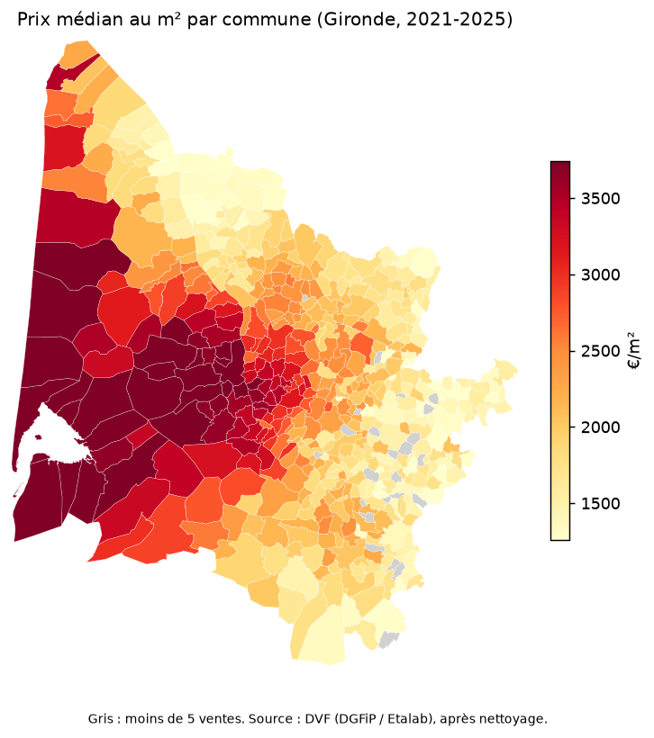
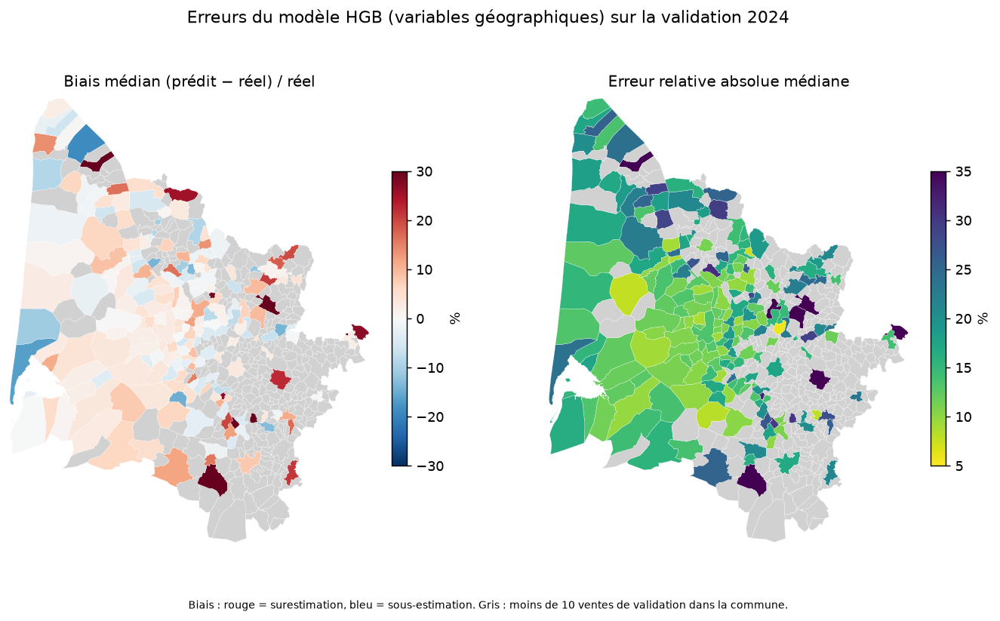

# Prédiction du prix au m² — DVF (Gironde)

Projet data : prédire le prix au m² des appartements et maisons à partir des
[Demandes de valeurs foncières](https://www.data.gouv.fr/fr/datasets/demandes-de-valeurs-foncieres-geolocalisees/)
(DGFiP / Etalab, Licence Ouverte 2.0).

**Stack** : Python, pandas, scikit-learn, Streamlit. **MVP** : Gironde (33), 2021–2025.

> Statut : sprints 1 à 5 terminés (données, nettoyage, baseline, modèles, géographie et cartes). Voir l'avancement ci-dessous.

## Installation

```bash
python -m venv .venv
.venv\Scripts\activate          # Windows (Linux/macOS : source .venv/bin/activate)
pip install -r requirements.txt
```

## Reproduire les étapes

```bash
set PYTHONPATH=src              # PowerShell : $env:PYTHONPATH="src"
python -m immo.download         # télécharge data/raw/*.csv.gz + data/manifest.json
pytest                          # tests unitaires + tests sur les vrais fichiers
```

La configuration (département, années) est dans `config.yaml`.

## Structure

```
config.yaml          paramètres (département, années, chemins)
src/immo/            download, loader, clean, split, baseline, features, geo, neighbors, models, train,
                     evaluate, spatial, maps, metrics, config
tests/               pytest
notebooks/           01_exploration.ipynb
reports/             funnel.csv, metrics.json, best_params.json, spatial_cv.json, erreurs_par_commune.csv,
                     figures/ (cartes PNG)
models/              modèles entraînés (gitignoré)
data/                raw/ (gitignoré), manifest.json (versions + SHA-256), README.md
```

## Données

Voir [data/README.md](data/README.md) : source, schéma, périmètre, version figée.

## Nettoyage (sprint 2)

```bash
python -m immo.clean    # -> data/processed/ventes_clean.parquet + reports/funnel.csv
```

Règles : ventes uniquement ; une seule disposition ; aucun local commercial ; **un seul
logement par mutation** (les lignes répétées d'un même bien, une par nature de culture, sont
fusionnées ; les mutations multi-logements sont écartées car le prix n'est pas ventilable) ;
dépendances tolérées (`has_dependance`) ; surface de terrain = somme des morceaux de terrain
distincts ; bornes de surface, pièces, prix minimal et garde-fous prix/m² (`config.yaml`).
Les bornes par quantiles (P1–P99) sont **estimées sur le train uniquement**
(`fit_price_bounds` / `apply_price_bounds`, utilisées au sprint 3).

Entonnoir (Gironde 2021–2025, en mutations) :

| Étape | Mutations restantes | Perdues |
|---|---:|---:|
| Lignes brutes | 187 909 | — |
| Nature = Vente | 171 718 | 16 191 |
| Une seule disposition | 171 573 | 145 |
| Sans local industriel/commercial | 162 903 | 8 670 |
| Au moins un appartement ou une maison | 122 615 | 40 288 |
| Exactement un local principal | 117 275 | 5 340 |
| Prix renseigné | 117 213 | 62 |
| Surface bâtie dans les bornes | 117 139 | 74 |
| Nombre de pièces dans les bornes | 117 072 | 67 |
| Prix minimal (15 000 €) | 116 773 | 299 |
| Terrain maison ≤ 10 000 m² | 115 109 | 1 664 |
| Prix/m² entre 200 et 25 000 € | **114 887** | 222 |

Résultat : 46 221 appartements et 68 666 maisons, 1,7 % sans coordonnées (conservées avec
l'indicateur `coords_missing`, à imputer dans le pipeline de modélisation).

## Validation et baseline (sprint 3)

```bash
python -m immo.evaluate          # ajuste sur 2021-2023, évalue sur la validation 2024 -> reports/metrics.json
```

- **Découpage temporel** (`config.yaml`, section `split`) : train 2021–2023 (75 169 ventes),
  validation 2024 (17 793), **test 2025 (21 925) réservé à l'évaluation finale** (`--test`, une seule fois,
  avec ajustement sur train+validation).
- **Anti-fuite** : les bornes P1–P99 du prix/m² sont estimées sur les données d'ajustement et ne servent
  qu'à les filtrer ; les jeux d'évaluation ne sont jamais tronqués. La baseline ne lit jamais la cible
  du jeu évalué (testé).
- **Baseline** : médiane du prix/m² par (commune, type), avec repli sur la médiane du type si la commune a
  moins de 5 ventes dans le train (0,65 % des ventes de 2024).

Résultats de la baseline sur la validation 2024 :

| | n | MAE (€/m²) | MAPE | MAPE médiane | biais (€/m²) | R² |
|---|---:|---:|---:|---:|---:|---:|
| Ensemble | 17 793 | 899 | 33,0 % | 17,3 % | +64 | 0,46 |
| Appartements | 7 433 | 851 | 26,0 % | 15,5 % | +119 | 0,42 |
| Maisons | 10 360 | 933 | 38,1 % | 18,8 % | +25 | 0,47 |

Pour situer la difficulté : prédire la médiane globale du type de bien donne une MAE de 1 321 €/m²
(MAPE 52 %). La médiane par commune la réduit déjà de 32 %. La baseline ignore la surface, les
pièces, la date et les coordonnées ; les sprints suivants les ajoutent.
La MAPE (moyenne) est tirée vers le haut par les biens à faible prix/m² ; la MAPE médiane est plus robuste.

## Modèles (sprint 4)

```bash
python -m immo.train             # réglage (CV temporelle sur le train) + évaluation sur la validation 2024
python -m immo.evaluate          # ré-évalue avec reports/best_params.json (sans re-régler)
```

- **Variables** (`features.py`) : surface (et log), pièces, surface/pièce, maison/appartement, terrain (maisons),
  dépendance, lots, index mensuel, commune et commune×type (encodage cible), latitude/longitude
  (+ 2 axes tournés à 45°). Les coordonnées manquantes sont remplacées par le centroïde de la commune
  appris sur le train.
- **Anti-fuite** : tout ce qui s'apprend (centroïdes, `TargetEncoder` validé en 5 plis, normalisation) est dans
  le `Pipeline` et ajusté sur les données d'ajustement seules (testé : l'encodeur ne connaît que les communes du train).
- **Cible** : log(prix/m²), prédiction ramenée en €/m².
- **Ridge** : interactions d'ordre 2 + régularisation. **HistGradientBoosting** (HGB) : perte absolue, jusqu'à 1 000
  itérations. Hyperparamètres choisis par validation croisée temporelle à fenêtre croissante sur le train
  (2021 → 2022, 2021-22 → 2023), critère MAE ; ils sont dans `reports/best_params.json`.

Résultats sur la validation 2024 (17 793 ventes), détaillés avec les variantes géographiques plus bas :
Ridge −7,3 % et HGB −19,5 % de MAE par rapport à la baseline.

Par type de bien, HGB : appartements MAE 644 €/m² (MAPE 18,6 %), maisons MAE 781 €/m² (MAPE 32,7 %).
Les maisons sont plus difficiles : le prix/m² dépend beaucoup du terrain, de l'état et de la situation exacte,
absents des données.

La validation 2024 a servi à choisir quelques options de conception (index temporel pour HGB seulement) ;
le test 2025 reste intact.

## Géographie et validation spatiale (sprint 5)

```bash
python -m immo.geo               # télécharge les communes (contours, population) : data/raw/communes_33.geojson
python -m immo.train             # réglage des 4 modèles + validation 2024
python -m immo.spatial           # validation spatiale (GroupKFold) -> reports/spatial_cv.json
python -m immo.maps              # cartes -> reports/figures/*.png (+ HTML interactifs dans reports/maps/)
```

Variables ajoutées (variantes `_geo`) :
- distance au centre de Bordeaux et **au littoral** (trait de côte tracé à la main avec ~11 points, précision ±3 km :
  c'est une approximation, vérifiée sur des lieux connus dans les tests) ;
- population et densité de la commune (geo.api.gouv.fr, instantané récent : variable de contexte) ;
- **prix des ventes voisines** : médiane du prix/m² des 10 ventes de même type les plus proches **strictement
  antérieures** dans le jeu d'ajustement (une vente ne voit jamais elle-même, ni le futur, ni une vente du même jour ;
  testé).

Validation 2024 (ajustement sur 2021-2023) :

| Modèle | MAE (€/m²) | vs baseline | MAPE | MAPE médiane | R² |
|---|---:|---:|---:|---:|---:|
| Baseline (médiane par commune) | 899 | — | 33,0 % | 17,3 % | 0,46 |
| Ridge | 833 | −7,3 % | 29,2 % | 16,0 % | 0,50 |
| Ridge + géographie | 774 | −13,9 % | 28,3 % | 15,1 % | 0,61 |
| HGB | 724 | −19,5 % | 26,8 % | 13,9 % | 0,65 |
| **HGB + géographie** | **717** | **−20,2 %** | 26,5 % | 13,6 % | 0,66 |

La géographie aide beaucoup le modèle linéaire (−7 % de MAE) mais peu l'HGB (−1 %) sur 2024 : les arbres
exploitent déjà latitude, longitude et commune. Appartements (HGB + géo) : MAE 630 €/m², MAPE 18,2 % ;
maisons : MAE 779 €/m², MAPE 32,5 %.

**Validation spatiale** (5 plis sur les ventes 2021-2024, sans tenir compte du temps ; le test 2025 n'est pas utilisé).
Dans le schéma « commune », les communes évaluées sont absentes de l'entraînement : c'est le cas d'usage d'une
commune où l'on a peu ou pas d'historique.

| Schéma | Baseline | HGB | HGB + géographie |
|---|---:|---:|---:|
| Commune (534 groupes), MAE €/m² | 1 446 | 1 173 | **1 044** |
| Commune, MAPE | 52,2 % | 37,2 % | **32,9 %** |
| Blocs de 5 km (409 groupes), MAE €/m² | 1 079 | 842 | 837 |
| Blocs de 5 km, MAPE | 40,4 % | 29,2 % | 28,2 % |

- Sur une commune jamais vue, la baseline retombe sur la médiane du type de bien (R² ≈ 0) ; les variables
  géographiques réduisent l'erreur de l'HGB de **11 %** (1 173 → 1 044).
- Dans le schéma par blocs de 5 km, l'écart géographique disparaît : une même commune est souvent répartie sur
  plusieurs blocs, donc l'encodage de la commune reste informatif. Ce schéma est moins sévère qu'il n'y paraît.
- Les erreurs par pli varient fortement (de 718 à 1 405 €/m² pour l'HGB + géo, schéma commune) : le pli qui contient
  les grandes communes est le plus difficile.

**Cartes** (validation 2024, modèle HGB + géographie) :




Les prix les plus élevés se concentrent sur le littoral du Bassin d'Arcachon et autour de Bordeaux, les plus bas
dans l'est et le sud rural. Les erreurs ne sont calculées que pour les communes ayant au moins 10 ventes de validation
(206 sur 491) : le reste, surtout rural, est grisé. Les communes en rouge foncé (surestimation) sont des cas isolés à
faible effectif.

## Avancement

| Sprint | Contenu | État |
|---|---|---|
| S1 | Données : téléchargement, lecture typée, exploration | ✅ |
| S2 | Nettoyage (multi-lots, doublons, aberrants) | ✅ |
| S3 | Découpage temporel + baseline | ✅ |
| S4 | Ridge + HistGradientBoosting | ✅ |
| S5 | Variables géographiques, validation spatiale, cartes | ✅ |
| S6 | App Streamlit, déploiement | à faire |
